# ДЗ 3: MovieLens у Neo4j

Тут я завантажив MovieLens 1M у Neo4j (6 040 юзерів, 3 883 фільми, 1 000 209 оцінок) і пограв з ним: прості фільтри, рекомендації, найкоротший шлях між людьми, пошук супервузлів. [Умова завдання](https://www.edu.goit.global/uk/learn/43680627/49489220/52105983/homework).

Зробив обов'язкові частини 1–4 і 6. Частину 5 з GDS не робив, вона необов'язкова, тому `part5_gds.cypher` немає.

## Що де лежить

```text
03/
├── README.md
├── docker-compose.yml          # Neo4j з умови (варіант A)
├── convert.py                  # .dat -> .csv
├── part2_load.cypher           # індекси + завантаження + перевірки
├── queries/
│   ├── part3.cypher            # 6 запитів
│   └── part4_supernodes.cypher # супервузли
├── screenshots/                # скріни з Neo4j Browser
└── import/                     # сюди convert.py кладе csv, звідси їх читає Neo4j (csv в гіт не йдуть)
```

## Як запустити

```bash
cd 03
curl -LO https://files.grouplens.org/datasets/movielens/ml-1m.zip
unzip ml-1m.zip && cp ml-1m/*.dat .

python convert.py
# movies.csv: 3883 рядків
# ratings.csv: 1000209 рядків
# users.csv: 6040 рядків

docker-compose up -d
```

Потім `http://localhost:7474`, логін `neo4j`, пароль `password123`, і по черзі запускаю `part2_load.cypher`, `queries/part3.cypher`, `queries/part4_supernodes.cypher`. Можна і через консоль:

```bash
docker exec -i neo4j_movielens cypher-shell -u neo4j -p password123 < part2_load.cypher
```

У себе я ганяв усе на Neo4j Community 5.26 з APOC, а в `docker-compose.yml` версія 5.18, як в умові. Нічого такого, чого нема в 5.18, я не використовую.

`convert.py` майже такий самий, як в умові, тільки я ще витягую рік з назви (`Toy Story (1995)` → `1995`) в окрему колонку. Інакше `year` у схемі просто не було б звідки взяти.

---

## Частина 1. Схема

```text
                         (:Genre)
                         { name }            18 шт
                             ▲
                             │ [:HAS_GENRE]  6 408
                             │
 (:User)  ──[:RATED {rating, timestamp}]──►  (:Movie)
 { userId,                                    { movieId,
   gender,          1 000 209 ребер             title,
   age,                                         year }
   occupation }                               3 883 шт
 6 040 шт
```

Так само її показує `CALL db.schema.visualization()`:


Індекси й обмеження: unique на `User.userId`, `Movie.movieId`, `Genre.name` і звичайний індекс на `RATED.rating`, бо майже всі запити фільтрують по оцінці.

### Що вузли, а що ребра

Вузлами я зробив юзерів, фільми і жанри, тобто те, що існує саме по собі. Юзер лишається юзером, навіть якщо нічого не оцінив, а жанр спільний для купи фільмів. Ребра означають дії і зв'язки: «оцінив» і «належить до жанру». Без двох кінців вони сенсу не мають.

Стать, вік і професію лишив звичайними властивостями юзера. Думав зробити `Occupation` окремим вузлом, але жоден запит не питає «люди тієї ж професії», а значень там лише 21, тож кожен такий вузол одразу був би на сотні юзерів. Zip-код не вантажив зовсім, він ніде не потрібен.

### Оцінка: ребро чи вузол Rating

Обрав ребро `(:User)-[:RATED {rating, timestamp}]->(:Movie)`.

Чому:
- шлях коротший. Юзер → фільм → юзер — це 2 кроки, а через вузол `Rating` було б 4 (`User → Rating → Movie ← Rating ← User`). У запитах 3, 5 і 6 це дуже відчутно;
- менше даних: мільйон ребер замість мільйона вузлів плюс двох мільйонів ребер;
- запит читається так, як звучить задача: `(u)-[r:RATED]->(m) WHERE r.rating >= 4`;
- у MovieLens одна людина ставить одному фільму одну оцінку, тож пару (юзер, фільм) однозначно описує одне ребро, і `MERGE` нормально ловить дублі.

Але є випадки, коли вузол `Rating` був би кращим:
- якщо до оцінки треба щось причепити (рецензію, теги, лайки інших людей). Ребро до ребра не під'єднаєш;
- якщо людина може переоцінювати фільм і треба зберігати історію. Тоді між тими самими юзером і фільмом буде кілька ребер, `MERGE` вже не допоможе, і запити стануть кривими;
- запит «усі оцінки за такий-то період» з вузлами робиться простіше: індекс на вузол, і все.

Для нашого датасету нічого з цього не потрібно: оцінка тут просто число й час, а основна робота — це обходи. Тому ребро.

### Чому жанри окремими вузлами

1. «Фільми жанру X» — це просто пройти від одного вузла жанру по його ребрах. Якби жанри були списком у фільмі, довелося б перебрати всі 3 883 фільми і в кожному перевірити `'Thriller' IN m.genres`.
2. Через жанр можна будувати шляхи: «схожі за жанром фільми», «улюблені жанри юзера» (`(u)-[:RATED]->()-[:HAS_GENRE]->(g)`). На цьому побудований запит 4.
3. Назва жанру зберігається в одному місці. Наприклад, `Children's` з апострофом записаний раз, а не в кожному фільмі.
4. На жанр можна повісити свої властивості, наприклад закешований середній рейтинг (про це в частині 4).

Мінус: жанрів лише 18, і Drama пов'язана з 41% усіх фільмів. Тобто це супервузол, про що далі.

---

## Частина 2. Завантаження

Весь код у [`part2_load.cypher`](part2_load.cypher). Можна запускати скільки завгодно разів.

**Індекси першими.** Unique constraint одразу створює індекс і не дає зробити дубль. Створюю їх до завантаження, щоб кожен `MERGE`/`MATCH` по id шукав через індекс. Без цього на мільйоні оцінок кожен рядок перебирав би всіх юзерів і всі фільми. `IF NOT EXISTS` додав, щоб при повторному запуску не вилітала помилка «вже існує».

**Юзери і фільми.** `LOAD CSV WITH HEADERS` дає кожен рядок як мапу. У `MERGE` ставлю тільки id, а решту пишу через `SET`. Якщо запхати в `MERGE` усі поля, то при зміні, скажімо, віку повторний запуск створить нового юзера-дубля. І ще: з csv усе приходить рядками, тому `toInteger`, інакше `{userId: 1}` не знайде вузол з `"1"`.

**Жанри.** Ще раз читаю `movies.csv`, ріжу `Animation|Children's|Comedy` по `|`, а `UNWIND` розкладає список на окремі рядки. `MERGE` на жанр і на ребро, тож кожен жанр і кожен зв'язок з'являються один раз. Рядків тут 6 408, тому однієї транзакції вистачає.

**Оцінки.** Мільйон рядків в одній транзакції впаде по пам'яті, тому `apoc.periodic.iterate`: перший запит читає csv, другий для кожного рядка знаходить юзера і фільм і робить `MERGE` ребра. Коміт кожні 10 000, всього вийшов 101 батч.

`parallel: false` тому, що `MERGE` ребра блокує обидва вузли, а одні й ті самі вузли є майже в кожному батчі (American Beauty оцінили 3 428 разів). Паралельні потоки просто стояли б і чекали один одного або ловили deadlock. Все одно оцінки залились за 43 секунди, тож прискорювати не було сенсу.

```text
batches: 101, total: 1000209, committedOperations: 1000209, failedOperations: 0, errorMessages: {}
```

**Перевірка:**

| Що | Вийшло | Має бути |
|---|---:|---:|
| User | 6 040 | 6 040 рядків у users.dat |
| Movie | 3 883 | 3 883 рядки в movies.dat |
| Genre | 18 | 18 жанрів |
| RATED | 1 000 209 | 1 000 209 рядків у ratings.dat |
| HAS_GENRE | 6 408 | сума жанрів по всіх фільмах |
| дублі оцінок | 0 рядків | 0 |

| | |
|---|---|
| 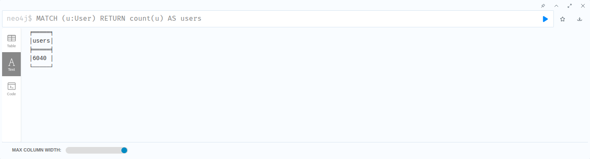 |  |
| 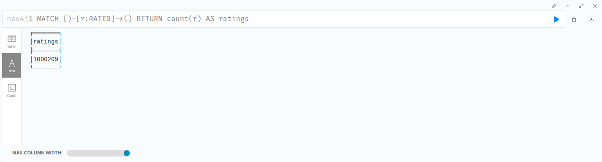 | 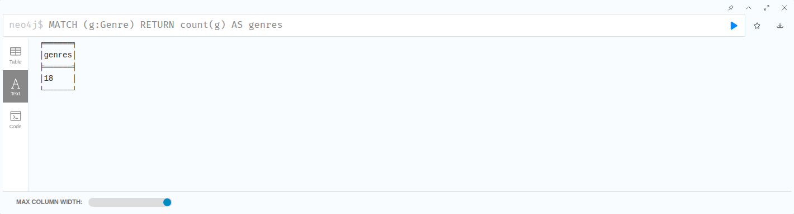 |
| 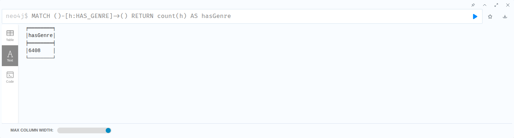 | 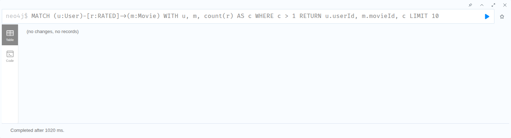 |

Для перевірки на дублі я запустив увесь файл вдруге: усі цифри лишились ті самі.

---

## Частина 3. Запити

Усі в [`queries/part3.cypher`](queries/part3.cypher).

### Запит 1. Трилери із середньою оцінкою > 4.0

```cypher
MATCH (g:Genre {name: 'Thriller'})<-[:HAS_GENRE]-(m:Movie)<-[r:RATED]-(:User)
WITH m, avg(r.rating) AS avgRating, count(r) AS numRatings
WHERE avgRating > 4.0 AND numRatings >= 50
RETURN m.title AS title, round(avgRating, 3) AS avgRating, numRatings
ORDER BY avgRating DESC, numRatings DESC;
```

Починаю з вузла Thriller, далі йду до його фільмів, а від них до оцінок. `WITH` тут працює як `GROUP BY` по фільму, а `WHERE` після нього як `HAVING`.

Поріг у 50 оцінок додав від себе: фільм з однією п'ятіркою має середнє 5.0, але «високо оціненим» його назвати важко. Чесно кажучи, тут поріг відсік лише один фільм з 52 (у найменш популярного 43 оцінки), але на урізаному датасеті для AuraDB він би вже мав значення. Вийшов 51 фільм, угорі «Звичайні підозрювані», «Вікно у двір», «Третя людина». Першим стоїть Wallace & Gromit `A Close Shave`, бо в MovieLens він чомусь записаний ще й як Thriller.

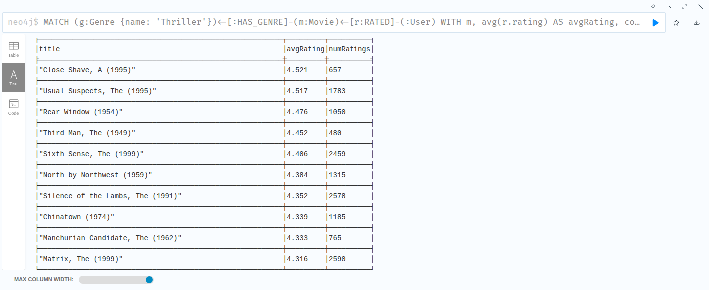

### Запит 2. Хто поставив п'ятірку більш ніж 50 фільмам

```cypher
MATCH (u:User)-[r:RATED]->(:Movie)
WHERE r.rating = 5
WITH u, count(r) AS fives
WHERE fives > 50
RETURN u.userId AS userId, u.gender AS gender, u.age AS age, fives
ORDER BY fives DESC
LIMIT 25;
```

Спочатку лишаю тільки п'ятірки, потім рахую їх по юзеру і фільтрую `> 50`. `LIMIT 25` просто щоб не виводити всіх. Другим запитом у файлі порахував, скільки таких юзерів узагалі: 1 390 з 6 040. Рекордсмен — юзер 4277 з 571 п'ятіркою.

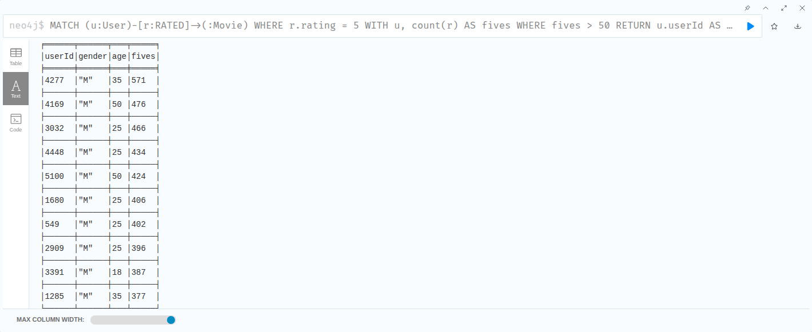
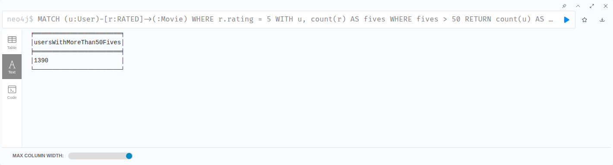

### Запит 3. Фільми, які обидва юзери оцінили на 4+

```cypher
MATCH (u1:User {userId: 1})-[r1:RATED]->(m:Movie)<-[r2:RATED]-(u2:User {userId: 2})
WHERE r1.rating >= 4 AND r2.rating >= 4
RETURN m.title AS title, r1.rating AS user1Rating, r2.rating AS user2Rating
ORDER BY user1Rating + user2Rating DESC, title;
```

Обидва юзери знаходяться по індексу, а `m` посередині і є «фільм, який оцінили обидва». Проходити треба тільки ребра цих двох людей (53 і 129), тому запит миттєвий.

Спільних фільмів у них лише 7, і в 6 обидва поставили 4+: «Пролітаючи над гніздом зозулі» (обидва 5), «Пробудження», «Товариство мертвих поетів», «Шофер міс Дейзі», «Врятувати рядового Райана», «Убити пересмішника». Сортую по сумі оцінок, щоб нагорі був фільм, який обом сподобався найбільше.

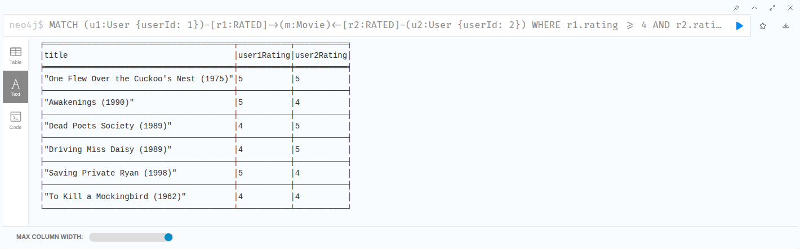

### Запит 4. Жанри з високими оцінками

```cypher
MATCH (g:Genre)<-[:HAS_GENRE]-(:Movie)<-[r:RATED]-(:User)
WITH g,
     avg(r.rating)  AS avgRating,
     count(r)       AS numRatings,
     sum(CASE WHEN r.rating >= 4 THEN 1 ELSE 0 END) AS high
RETURN g.name AS genre, round(avgRating, 3) AS avgRating, numRatings,
       round(100.0 * high / numRatings, 1) AS share45
ORDER BY avgRating DESC;
```

Крім середньої і кількості, які просили, додав `share45`, тобто відсоток оцінок 4 і 5. Мені здається, саме він краще показує «стабільно високі». Середнє 3.7 може вийти і з самих трійок-четвірок, і з суміші одиниць з п'ятірками. Якщо у фільму три жанри, його оцінка йде в усі три, і це нормально: питання ж про те, як оцінюють фільми жанру.

| Жанр | Середнє | Оцінок | Частка 4–5 |
|---|---:|---:|---:|
| Film-Noir | 4.075 | 18 261 | 76.3% |
| Documentary | 3.933 | 7 910 | 72.3% |
| War | 3.893 | 68 527 | 69.4% |
| Drama | 3.766 | 354 529 | 64.4% |
| Crime | 3.709 | 79 541 | 62.0% |
| … | | | |
| Children's | 3.422 | 72 186 | 51.6% |
| Horror | 3.215 | 76 386 | 44.6% |

Мене трохи здивувало, що вгорі нішеві жанри. Але, думаю, логіка така: нуар і документалки дивляться ті, хто їх свідомо обирає, і там переважно стара класика, яку вже «відфільтрував» час. Комедії і бойовики дивляться всі підряд, тому оцінок багато, а середнє нижче. Horror — єдиний жанр, де 4–5 менше половини.

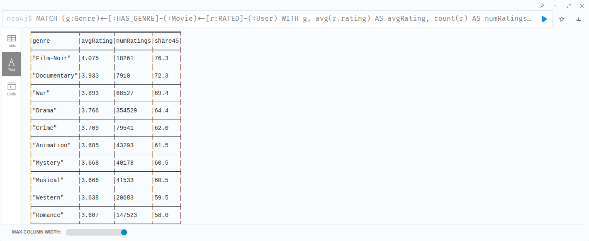

### Запит 5. «Схожі люди також дивились»

```cypher
MATCH (target:User {userId: 1})-[r1:RATED]->(m:Movie)<-[r2:RATED]-(other:User)
WHERE r1.rating >= 4 AND r2.rating >= 4 AND other <> target
WITH target, other, count(m) AS overlap
WHERE overlap >= 10
ORDER BY overlap DESC
LIMIT 25
MATCH (other)-[r:RATED]->(rec:Movie)
WHERE r.rating >= 4 AND NOT (target)-[:RATED]->(rec)
WITH rec, count(DISTINCT other) AS recommenders, avg(r.rating) AS avgBySimilar
RETURN rec.title AS recommendation, recommenders, round(avgBySimilar, 2) AS avgBySimilar
ORDER BY recommenders DESC, avgBySimilar DESC
LIMIT 10;
```

Найважче тут було вирішити, хто такі «схожі». Зупинився на такому:

1. схожий юзер — той, хто теж поставив 4+ тим самим фільмам, що й юзер 1. `overlap` рахує, скільки таких фільмів. Беру топ-25 і щоб збігів було хоча б 10, інакше схожим стає будь-хто, з ким випадково збіглись два фільми;
2. дивлюсь, що ці 25 людей оцінили на 4+;
3. викидаю все, що юзер 1 уже оцінював (з будь-якою оцінкою);
4. сортую по тому, скільки сусідів «порадили» фільм, а при рівності — по їхній середній оцінці.

Для юзера 1 вийшли «Це прекрасне життя» (порадили 24 з 25), «Мовчання ягнят», «Втеча з Шоушенка», «Імперія завдає удару у відповідь», «Форрест Гамп», «Король Лев», «Бейб». Юзер 1 — дівчина до 18 років, у якої серед оцінок купа Діснея (Dumbo, Bambi, Cinderella, Toy Story 2), тому «Король Лев» і «Бейб» виглядають логічно. Але видно, що рекомендації все одно тягнуть до загальновідомих хітів. Це якраз через супервузли (частина 4).

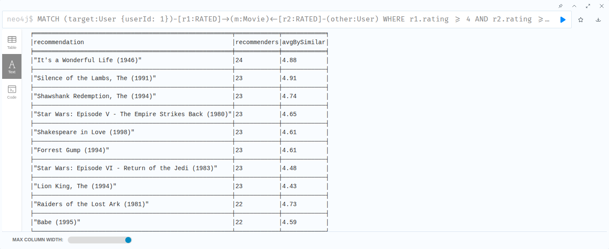

### Запит 6. Найкоротший шлях між двома юзерами

```cypher
MATCH (a:User {userId: 1}), (b:User {userId: 2})
MATCH p = shortestPath((a)-[:RATED*..10]-(b))
RETURN length(p) AS pathLength,
       [n IN nodes(p) | CASE WHEN n:User THEN 'User ' + n.userId ELSE n.title END] AS chain;
```

`shortestPath` шукає в ширину з обох кінців. Тип ребра `RATED` вказав явно, бо інакше шлях міг би піти через жанр (`User → Movie → Genre → Movie → User`), а це вже не «через спільні фільми». `..10` — це обмеження, щоб для незв'язаної пари запит не обходив увесь граф. А `CASE` в кінці замінює вузли на нормальні підписи: для юзера id, для фільму назва.

- юзери 1 і 2: довжина 2, `User 1 → Awakenings (1990) ← User 2`;
- щоб побачити довший шлях, я знайшов пару без жодного спільного фільму, 3273 і 4068 (у обох по 20 оцінок, це мінімум у датасеті). Довжина 4: `User 3273 → Men in Black ← User 493 → A Civil Action ← User 4068`.

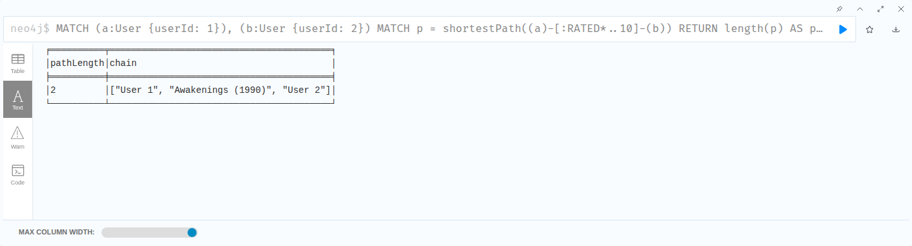
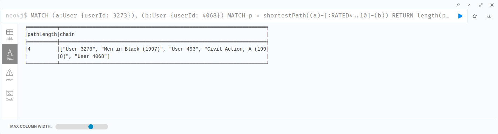

**Що означає довжина шляху.** `RATED` завжди з'єднує юзера з фільмом, тому в шляху юзери і фільми чергуються, а довжина між двома юзерами завжди парна.

- 2 (`U – M – U`): обидва оцінили один фільм. Найближчий можливий зв'язок.
- 4 (`U – M – U' – M' – U`): спільних фільмів немає, але є третя людина, яка дивилась щось і з фільмів першого, і з фільмів другого. Як «друг друга».
- 6 (`U – M – U' – M' – U'' – M'' – U`): потрібні вже два посередники, тобто люди зовсім з різних світів.

Шостої довжини я так і не знайшов. Взяв 60 найменш активних юзерів, серед них набралось 744 пари без спільних фільмів, і для всіх 744 шлях вийшов рівно 4. Думаю, це через супервузли: American Beauty оцінили 57% людей, «Зоряні війни» — майже половина, тож посередник знаходиться майже завжди.

---

## Частина 4. Супервузли

Запити в [`queries/part4_supernodes.cypher`](queries/part4_supernodes.cypher). Ступінь вузла рахую через `COUNT { (n)--() }`: Neo4j бере кількість ребер зі статистики вузла і самі ребра не читає, тому навіть по всьому графу це виконується за частки секунди.

**1. Ступені по типах вузлів.** Видно, як сильно максимум відрізняється від медіани:

| Тип | Вузлів | Мін | Середнє | Медіана | p99 | Макс |
|---|---:|---:|---:|---:|---:|---:|
| Movie | 3 883 | 1 | 259.2 | 111 | 1 785 | 3 430 |
| User | 6 040 | 20 | 165.6 | 96 | 909 | 2 314 |
| Genre | 18 | 44 | 356.0 | 211 | 1 603 | 1 603 |

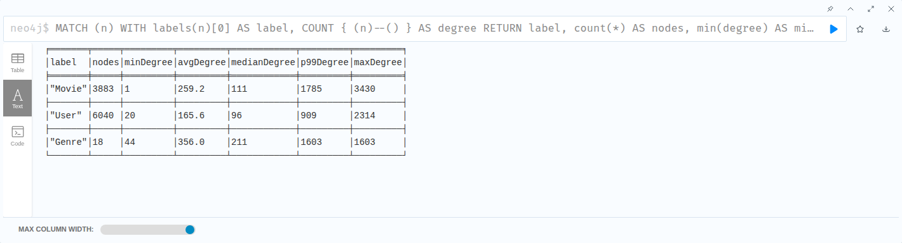

**2. Топ-10 за кількістю ребер.** Усі десять — фільми, від American Beauty (3 430) до Silence of the Lambs (2 580).

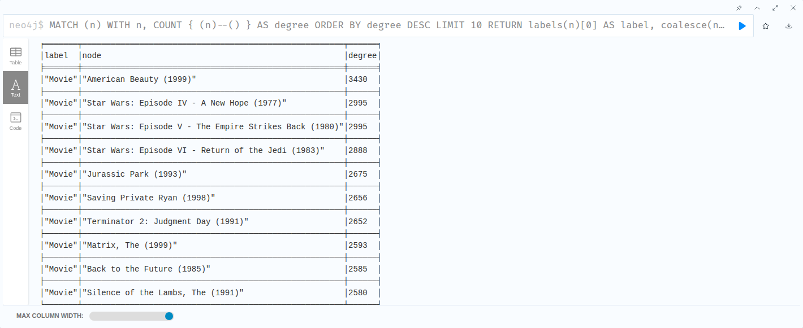

**3. Жанри.** Тут рахую ще й те, скільки оцінок «висить» за жанром, бо саме стільки ребер пройде будь-який запит, що починається з жанру.

| Жанр | Фільмів | % від усіх | Оцінок через жанр |
|---|---:|---:|---:|
| Drama | 1 603 | 41.3% | 354 529 |
| Comedy | 1 200 | 30.9% | 356 580 |
| Action | 503 | 13.0% | 257 457 |
| Thriller | 492 | 12.7% | 189 680 |
| … | | | |
| Film-Noir | 44 | 1.1% | 18 261 |

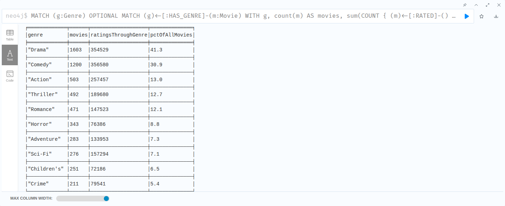

**4–5. Найпопулярніші фільми і найактивніші юзери.**

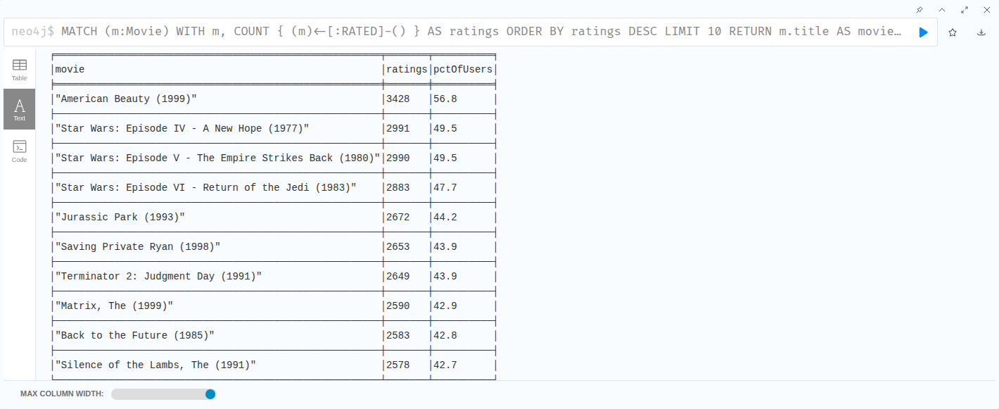
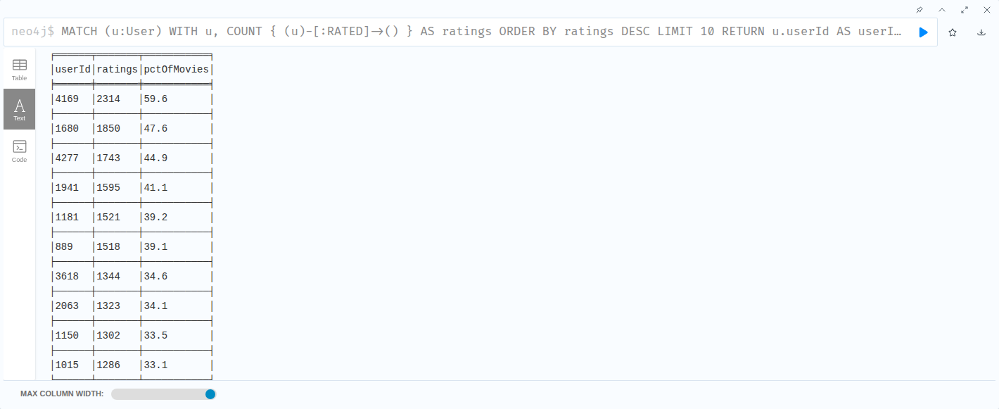

**6. Скільки коштує супервузол.** Один і той самий запит «що ще дивились ті, хто дивився X» для фільму з медіанною кількістю оцінок і для найпопулярнішого:

| Звідки старт | Оцінок | Рядків пройдено | db hits (PROFILE) |
|---|---:|---:|---:|
| Desperate Measures (1998), медіана | 111 | 66 700 | 133 958 |
| American Beauty (1999) | 3 428 | 714 252 | 1 444 952 |
| Drama → фільми → оцінки | — | 354 529 | 716 671 |
| Film-Noir → фільми → оцінки | — | 18 261 | 36 741 |

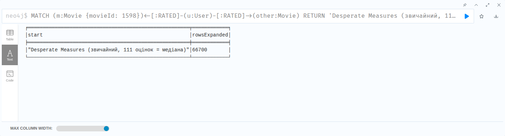
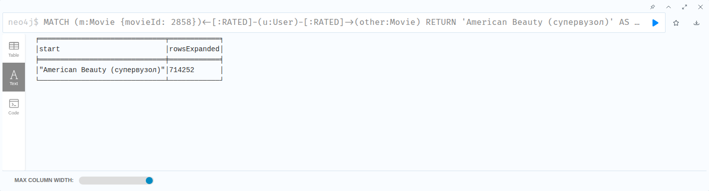
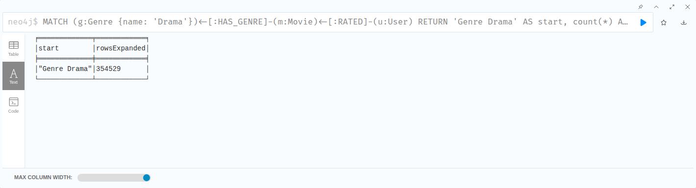

### Хто виявився супервузлами

- **Хітові фільми.** American Beauty має 3 428 оцінок, тобто її оцінили 57% усіх юзерів, у 31 раз більше, ніж медіанний фільм. Далі три «Зоряні війни» (2 991 / 2 990 / 2 883), «Парк Юрського періоду» (2 672), «Врятувати рядового Райана» (2 653), «Термінатор 2» (2 649), «Матриця» (2 590).
- **Дуже активні юзери.** Юзер 4169 оцінив 2 314 фільмів, це 60% усього каталогу. Як на мене, це вже більше схоже на бота, ніж на людину. Далі 1680 (1 850) і 4277 (1 743), при тому що медіана 96.
- **Жанри.** Власних ребер у них не так багато (у Drama 1 603 проти 3 430 у American Beauty), але відносно розміру графа вони найгірші. Drama пов'язана з 41% фільмів, Comedy з 31%, і через ці два жанри проходить понад 700 тисяч оцінок. Медіанний жанр має 211 фільмів, а Drama у 7.6 раза більше. Тож так, жанри теж супервузли, і, мабуть, найнеприємніші, бо майже кожен «жанровий» запит стартує саме з них.

### Чому через супервузол повільніше, якщо індекси ті самі

Індекс допомагає лише знайти стартовий вузол: American Beauty знаходиться так само швидко, як Desperate Measures. Далі індекси не працюють. Neo4j просто йде по ребрах вузла одне за одним, і чим їх більше, тим довше. На першому кроці це 3 428 ребер замість 111. На другому кожен з цих юзерів ще розгортає всі свої оцінки, і виходить 714 тисяч рядків проти 67 тисяч, а db hits 1.44 млн проти 134 тисяч. З кожним новим кроком різниця множиться.

Що ще погіршує ситуацію:
- фільтр `r.rating >= 4` нічого не зекономить: Neo4j спершу дістає ребро, читає його властивості і тільки тоді відкидає. Індекс на `RATED.rating` працює, коли запит починається з оцінок, а не коли розгортається конкретний вузол;
- у вузлів з великою кількістю ребер Neo4j групує ребра за типом, тож `-[:RATED]->` хоча б не перебирає `HAS_GENRE`. Але всередині одного типу перебір повний;
- запис у такий вузол блокує його для інших транзакцій, тому при завантаженні я і ставив `parallel: false`;
- і по суті: те, що двоє людей дивились «Зоряні війни», майже нічого не каже про їхні смаки, а таких «спільних фільмів» буде найбільше. Тож рекомендації через хіти ще й гірші за якістю.

### Що б я з цим робив

З **жанрами**:

1. Не починати запит з жанру. Від фільму до жанру в середньому 1.65 ребра, а від Drama до фільмів 1 603. Якщо фільм уже знайдено, перевірити `(m)-[:HAS_GENRE]->(:Genre {name:'Drama'})` дешево. Тобто жанр краще ставити фільтром у кінці, а не стартовою точкою.
2. Додати фільмам лейбли типу `:Thriller`, `:Drama`. Тоді `MATCH (m:Movie:Thriller)` дістає 492 фільми з індексу лейблів, без проходу по ребрах. Вузли `Genre` при цьому залишаю для запитів типу 4.
3. Порахувати агрегати заздалегідь. Запит 4 щоразу перебирає мільйон оцінок, хоча результат змінюється тільки коли з'являються нові. Я б записав `avgRating`, `numRatings`, `share45` у `Genre`, а `avgRating`, `numRatings` у `Movie`, і перераховував би це батчем. Тоді запит 4 читає 18 вузлів, а запит 1 обходить 492 ребра `HAS_GENRE` без жодного `RATED`.

З **хітами і дуже активними юзерами**:

4. Розділити ребра за типом: `LIKED` для 4–5, `RATED` для решти. Тоді запити 3 і 5 ходять тільки по позитивних ребрах, а решту Neo4j навіть не чіпає.
5. Відсікати хіти або давати їм меншу вагу в рекомендаціях і шляхах, наприклад `WHERE COUNT { (m)<-[:RATED]-() } < 2000` або вага `1 / log(кількість оцінок)`, як в TF-IDF. Буде і швидше, і рекомендації менш банальні.
6. Заздалегідь порахувати схожість: для кожного юзера топ-k ребер `SIMILAR {weight}`. Тоді запит 5 стартує з 25 готових сусідів. Власне, в частині 5 умови так і пропонують.

Розбивати супервузол на шматки по часу (типу `American Beauty / 2000-Q1`) тут, на мою думку, сенсу немає: оцінки всі за 2000–2003 роки, і жоден запит по часу не фільтрує.

---

## Частина 6. Висновки

### Граф чи SQL

Запити 1–4 у SQL пишуться без проблем, це звичайні `JOIN` + `GROUP BY` + `HAVING`, і PostgreSQL з індексами впорається не гірше. Запит 3, наприклад, це просто self-join `ratings r1 JOIN ratings r2 ON r1.movie_id = r2.movie_id WHERE r1.user_id = 1 AND r2.user_id = 2`. Запит 5 теж можна зробити через кілька CTE, тільки читати його потім буде боляче.

А от запит 6 у SQL — це проблема. У Cypher це один рядок `shortestPath((a)-[:RATED*..10]-(b))`. У SQL ми не знаємо, скільки буде кроків, тому потрібен рекурсивний CTE, де кожен крок — це ще два join'и таблиці на мільйон рядків:

```sql
WITH RECURSIVE reach(user_id, depth, path) AS (
    SELECT 3273, 0, ARRAY[3273]
  UNION ALL
    SELECT r2.user_id, reach.depth + 1, reach.path || r2.user_id
    FROM reach
    JOIN ratings r1 ON r1.user_id  = reach.user_id
    JOIN ratings r2 ON r2.movie_id = r1.movie_id
    WHERE r2.user_id <> ALL(reach.path)
      AND reach.depth < 3
)
SELECT min(depth) * 2 AS path_length
FROM reach
WHERE user_id = 4068;
```

Формально він є, але на практиці не дочекаєшся. PostgreSQL не вміє зупинитись, коли знайшов потрібного юзера, і не пам'ятає, кого вже відвідав (`path` ловить тільки цикли всередині одного шляху). Через American Beauty на першому кроці вже 3 428 рядків, на другому сотні тисяч, на третьому мільйони дублів тих самих людей, до яких дійшли різними дорогами. Neo4j робить нормальний пошук у ширину з двох боків, позначає відвідані вузли і зупиняється, щойно знайшов: у мене це 0.04 с. Щоб те саме зробити в SQL, довелося б писати BFS у PL/pgSQL з тимчасовою таблицею або ставити щось на кшталт pgRouting. Тобто це вже окремий алгоритм, а не запит. Те саме з «усі, до кого можна дійти за N кроків» чи з глибшими рекомендаціями: у графі глибина — це просто `*..N`, а в SQL це ще join на кожен рівень.

### Де граф програє

Коли треба пройтись по **всіх** даних, а не по сусідах одного вузла:

- Агрегати по всьому: «середня оцінка по роках», «скільки оцінок за кожен місяць», «оцінки за віком і статтю». У SQL це один `GROUP BY` по таблиці `ratings`, а в Neo4j треба розгорнути мільйон ребер і прочитати властивості кожного. Мій запит 4 найповільніший у всій роботі (~2 с) саме тому, що це аналітика, а не обхід.
- Звіти і BI: віконні функції (`RANK() OVER (PARTITION BY genre ...)`), зведені таблиці, підключити Metabase чи Tableau. Для SQL це стандарт, для Cypher щось на кшталт милиць.
- Експорт. Дані по суті табличні: `ratings.dat` — це рівно таблиця з чотирьох колонок. `COPY ratings TO 'file.csv'` віддає її за секунди, а з графа її треба збирати назад через `MATCH`.
- Строга схема: `NOT NULL`, `CHECK (rating BETWEEN 1 AND 5)`, типи колонок. У Neo4j Community такого для властивостей немає, і все доводиться контролювати самому. Я, наприклад, руками робив `toInteger` при завантаженні.

Якби я робив це для реального проєкту, то оцінки тримав би в SQL (або колонковій базі) для аналітики, а граф використовував би для рекомендацій і пошуку зв'язків.

### Що змінив би в схемі

1. **Запити 1 і 4.** Зберігати `avgRating`, `numRatings` у `Movie` і `Genre` і оновлювати, наприклад, раз на добу. Запит 1 тоді стає `MATCH (:Genre {name:'Thriller'})<-[:HAS_GENRE]-(m) WHERE m.avgRating > 4 AND m.numRatings >= 50`, тобто 492 ребра замість ~190 тисяч оцінок, а запит 4 просто читає 18 вузлів. Мінус у тому, що дані дублюються і їх треба синхронізувати.
2. **Запити 2, 3, 5.** Зробити окремий тип ребра `LIKED` для оцінок 4–5. Neo4j групує ребра за типом, тож `(u)-[:LIKED]->()` решту оцінок не чіпає. Для запиту 2 можна ще простіше: зберігати кількість п'ятірок у `User` (`u.fives`) і повісити на це індекс.
3. **Запит 5.** Заздалегідь порахувати `(:User)-[:SIMILAR {weight}]->(:User)` для топ-20 сусідів кожного (через GDS або батчем). Тоді найдорожча частина запиту, пошук схожих через хіти, просто зникає.
4. **Запит 6.** Якщо потрібен змістовний зв'язок, шукати шлях по `LIKED` або `SIMILAR` і не пускати через фільми-супервузли. Інакше майже будь-які двоє з'єднуються через American Beauty, і відповідь «4» нічого не означає.
